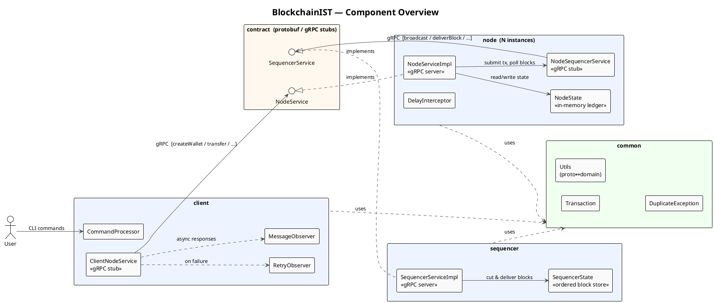
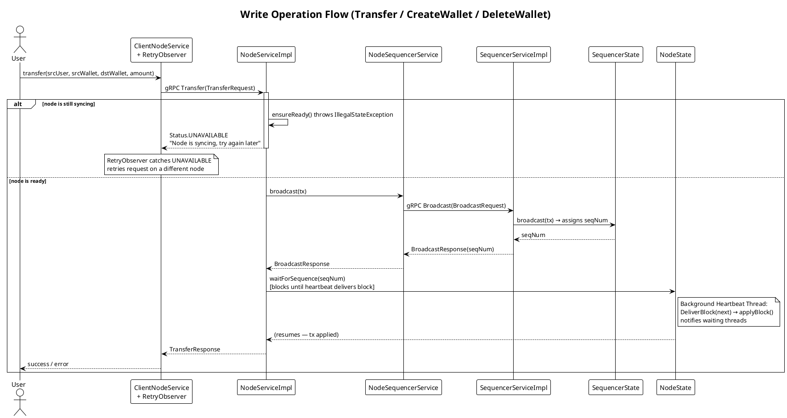
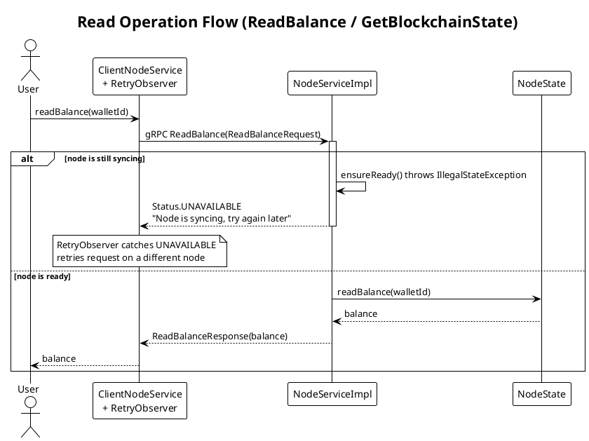
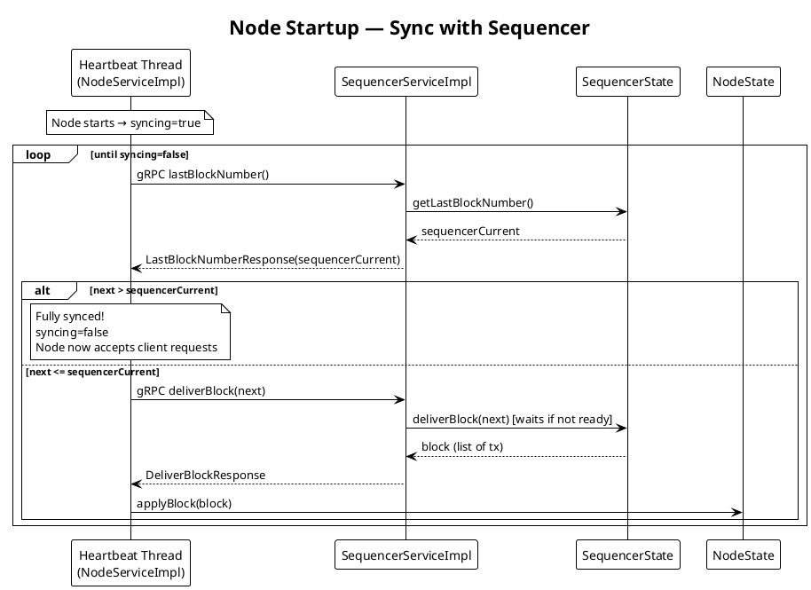
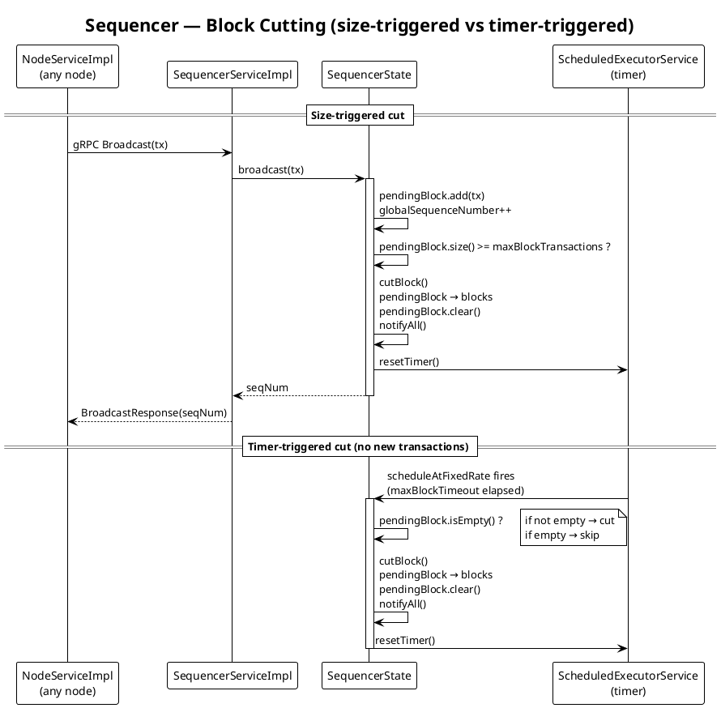
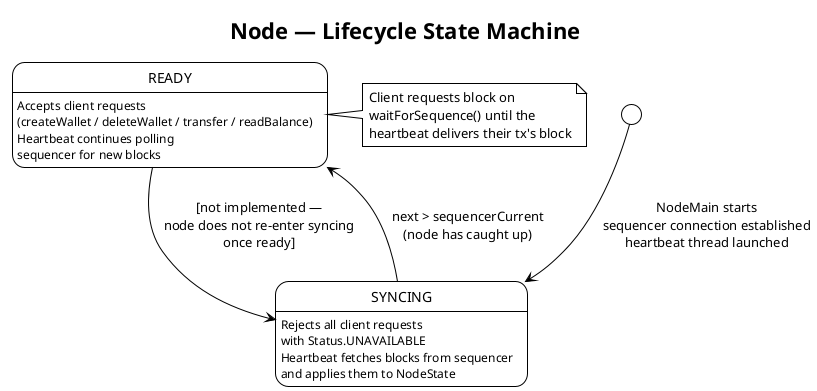
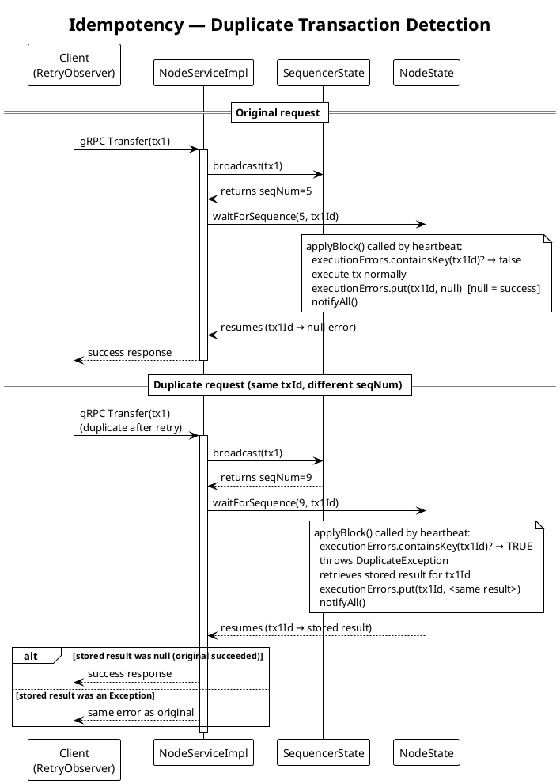

# BlockchainIST — Overall Architecture

## Component Diagram (High Level)

---

## Key Data Flow — Write Operation (e.g. Transfer)

---

## Key Data Flow — Read Operation (ReadBalance / GetBlockchainState)

---

## Key Data Flow — Node Startup Sync

---

## Block Cutting Flow (Sequencer)

---

## Node State Machine

---

## Duplicate Transaction Handling

---

---

## Module Responsibilities Summary

| Module | Role |
|--------|------|
| **client** | CLI front-end; sends gRPC requests to a node; retries on node failure via `RetryObserver` |
| **node** | Mediates client ↔ sequencer; holds local blockchain state; background heartbeat fetches ordered blocks from sequencer |
| **sequencer** | Total-order broadcast: batches transactions into blocks (by count or timeout), assigns global sequence numbers, lets nodes poll blocks |
| **common** | Shared domain model ([Transaction](file:///d:/projects/uni/SD/T52-BlockchainIST-2026/contract/src/main/proto/common.proto#30-38)), proto↔domain conversion (`Utils`), idempotency helper (`DuplicateException`) |
| **contract** | Protobuf definitions for all gRPC services and messages ([NodeService](file:///d:/projects/uni/SD/T52-BlockchainIST-2026/contract/src/main/proto/client-node.proto#33-49), [SequencerService](file:///d:/projects/uni/SD/T52-BlockchainIST-2026/contract/src/main/proto/node-sequencer.proto#35-45), [Transaction](file:///d:/projects/uni/SD/T52-BlockchainIST-2026/contract/src/main/proto/common.proto#30-38), etc.) |

---

## NodeState Internals

| Field | Type | Purpose |
|-------|------|---------|
| `wallets` | `Map<walletId, Wallet(ownerId, balance)>` | Live wallet registry; starts with a `bc` bank wallet seeded with 1000 |
| `ledger` | `List<Transaction>` | Append-only log of all applied transactions |
| `executionErrors` | `Map<txId, Exception>` | Stores per-tx failures so duplicate requests get the same error back |
| `currentSequence` | `int` | Highest applied sequence number; threads [wait()](file:///d:/projects/uni/SD/T52-BlockchainIST-2026/node/src/main/java/pt/tecnico/blockchainist/node/domain/NodeState.java#199-219) on this |
| `currentBlock` | `int` | Highest applied block number; used to poll sequencer |

## SequencerState Internals

| Field | Type | Purpose |
|-------|------|---------|
| `blocks` | `List<List<Transaction>>` | Immutable ordered block store |
| `pendingBlock` | `List<Transaction>` | Accumulates incoming tx until cut |
| `globalSequenceNumber` | `int` | Monotonically increasing counter across all tx |
| `scheduler` | `ScheduledExecutorService` | Fires a timer-based block cut when `maxBlockTimeout` elapses |
